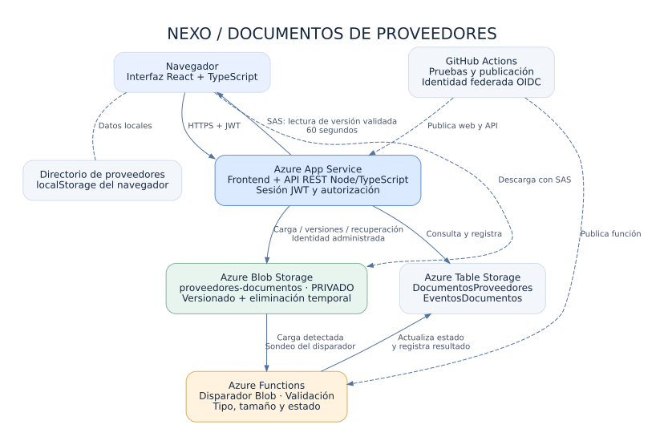

# Nexo · Proveedores y documentos en Azure

**Autor: Diego Zelada · Segunda etapa**

Amplié mi administrador de proveedores para gestionar sus documentos. Conservé la aplicación de React y agregué una API REST en Node.js y TypeScript, almacenamiento privado en Azure Blob Storage y una Azure Function que valida cada carga.

Para comenzar en Windows, sigo primero [EMPEZAR_AQUI.md](EMPEZAR_AQUI.md). La configuración de Azure está en [la guía de despliegue](docs/AZURE_PASO_A_PASO.md).

Para crear los servicios por separado y usar una API F1 existente, sigo [SERVICIOS_SEPARADOS.md](docs/SERVICIOS_SEPARADOS.md). Esa ruta usa Functions Flex con Event Grid, sin elegir B1. Su publicación real todavía debe comprobarse.

## Estado y enlaces

- Repositorio: [Diego-Zelada/nexo-proveedores](https://github.com/Diego-Zelada/nexo-proveedores).
- Dirección de la primera etapa: [Nexo en Static Web Apps](https://kind-mud-024de6410.6.azurestaticapps.net).
- Dirección de la segunda etapa: la devuelve el despliegue como `apiUrl`, con dominio `azurewebsites.net`. Se agrega aquí cuando se configure y pruebe en la cuenta de Azure.
- El código incluye infraestructura y publicación automática. Las capturas, la prueba de recuperación y la demostración en Azure se completan después del despliegue real. El enlace de la primera etapa no demuestra que la segunda ya esté publicada.

## Funciones

El directorio conserva el registro, edición, búsqueda, filtros, activación e inactivación de proveedores. Incluye los ocho ejemplos ficticios originales.

En **Documentos**, o en **⋯ → Ver documentos** de un proveedor, puedo:

- Iniciar sesión para gestionar mis documentos.
- Subir PDF, JPG/JPEG y PNG de hasta 10 MB por archivo.
- Asociarlos a un proveedor y clasificarlos como contrato, identificación, constancia fiscal u otro.
- Buscar por nombre o proveedor y filtrar por proveedor y tipo.
- Consultar nombre, tamaño, fecha y estado de procesamiento.
- Visualizar y descargar archivos validados mediante enlaces temporales de solo lectura.
- Cargar una nueva versión del mismo documento y consultar su historial en Azure.
- Eliminar documentos y solicitar su recuperación desde la papelera mientras Azure conserve versiones recuperables.

## Arquitectura



1. El navegador inicia sesión y envía el archivo a la API por HTTPS.
2. La API verifica la autorización y el archivo, crea su registro y lo carga en el contenedor privado `proveedores-documentos`.
3. El disparador Blob de Azure Functions detecta la carga, comprueba nuevamente tipo y tamaño, registra el resultado y actualiza el estado en Azure Table Storage.
4. La interfaz consulta el estado cada cinco segundos. El archivo solo se puede abrir cuando está `disponible`.
5. Para visualizar o descargar, la API genera un SAS de delegación de usuario, de solo lectura, para la versión validada y con 60 segundos de vigencia.

La API y el frontend se publican juntos en **Azure App Service**. La Function se publica como un recurso separado. GitHub Actions usa una identidad federada OIDC para publicar ambos.

### Dónde se guarda cada dato

| Dato                                                                       | Ubicación                                               |
| -------------------------------------------------------------------------- | ------------------------------------------------------- |
| Directorio de proveedores                                                  | `localStorage` del navegador, como en la primera etapa. |
| Archivos                                                                   | Contenedor privado de Azure Blob Storage.               |
| Asociación, tipo, nombre, tamaño y estado                                  | Tabla `DocumentosProveedores`.                          |
| Resultado de cargas, validaciones, enlaces, eliminaciones y recuperaciones | Tabla `EventosDocumentos` y registros del servidor.     |
| Token de sesión                                                            | Memoria del navegador; se pierde al recargar.           |
| Hashes de contraseñas y clave de firma                                     | `.env` local o configuración privada de App Service.    |

Los archivos se organizan como `usuario/proveedor/documento/archivo`; los identificadores son internos. Cada usuario ve únicamente su partición de documentos.

Los proveedores siguen siendo locales: no se sincronizan entre navegadores o direcciones web. Los documentos conservan el identificador y nombre del proveedor usados al subirlos. Aunque ese proveedor no exista en otro navegador, sus documentos siguen apareciendo en la consulta general del usuario. La API no es una base de datos central de proveedores.

## 1. Requisitos

- Node.js **22.12 o superior** y npm. Node 24 también sirve para trabajar localmente.
- Visual Studio Code; también puedo abrir la carpeta en Visual Studio y usar su terminal. No requiere un archivo `.sln`.
- Git para trabajar con el repositorio.
- Para la publicación: una suscripción de Azure, permisos para crear recursos y asignar roles, y Azure CLI.

En Windows compruebo:

```powershell
node --version
npm.cmd --version
git --version
```

Los comandos usan `npm.cmd` para evitar problemas de ejecución de `npm.ps1` en PowerShell. En macOS/Linux uso `npm`.

## 2. Instalación local

Abro en VS Code la carpeta que contiene este README y `package.json`. Si la segunda etapa ya está subida a GitHub, también puedo descargarla con `git clone`.

```powershell
npm.cmd ci
npm.cmd run configurar:local
```

El configurador solicita un usuario y una contraseña de al menos 12 caracteres. La contraseña no se muestra al escribir. Genera `.env` con el hash `scrypt` y una clave aleatoria de firma; no guarda la contraseña en texto. Conservo el archivo en mi computadora y no lo subo a GitHub. Si ya existe, el configurador se detiene para no sobrescribirlo.

En una primera terminal inicio Azurite, el emulador local de Azure Storage:

```powershell
npm.cmd run emulador
```

En una segunda terminal, dentro de la misma carpeta:

```powershell
npm.cmd run dev:completo
```

Abro [http://localhost:4173/](http://localhost:4173/), presiono **Documentos** e inicio sesión con el usuario y contraseña que elegí.

Mantengo ambas terminales abiertas. Para detenerlas uso **Ctrl + C** en cada una.

### Qué hace la prueba local

Azurite guarda datos de desarrollo en `.azurite/`. El comando `dev:completo` inicia Vite, la API en el puerto 3001 y un procesador local que reutiliza la misma validación de la Function. Azurite se inicia con su telemetría desactivada.

El procesador local permite practicar sin una cuenta de Azure; **no es el host de Azure Functions**. En Azure se utiliza la función real de `functions/src/index.ts`, con disparador Blob. El emulador tampoco reproduce todas las funciones de versionado y recuperación; esas pruebas se hacen en Azure real.

## 3. Usar los documentos

1. Abro **Documentos** e inicio sesión.
2. Selecciono proveedor, tipo y archivo. Puedo usar los archivos ficticios de `pruebas/archivos/`.
3. Presiono **Subir documento**. La respuesta inicial es `pendiente`.
4. Espero a que cambie a `disponible`. En local tarda unos segundos; en Azure el disparador por sondeo puede tardar varios minutos cuando el servicio está inactivo.
5. Uso **Ver** o **Descargar**. Si el enlace vence, solicito otro desde la aplicación.
6. Uso **Nueva versión** para reemplazar el contenido del mismo documento. En Azure, **Versiones** muestra el historial generado por Blob Storage.
7. Uso **Eliminar** y confirmo. El documento pasa a **Papelera**.
8. En Azure, abro **Papelera → Recuperar** mientras existan versiones recuperables. La recuperación vuelve a validar el archivo.

Si aparece `rechazado`, consulto el motivo. Si aparece `error`, reviso los registros; los fallos transitorios de la Function se reintentan. No puedo abrir archivos pendientes, rechazados o eliminados.

## 4. API REST

La documentación de campos y respuestas está en [docs/API.md](docs/API.md). Salvo inicio de sesión y comprobación de salud, todas las rutas requieren `Authorization: Bearer <token>`.

| Método | Ruta                                       | Operación                           |
| ------ | ------------------------------------------ | ----------------------------------- |
| POST   | `/api/auth/login`                          | Iniciar sesión.                     |
| GET    | `/api/auth/me`                             | Consultar sesión y límite.          |
| GET    | `/api/health`                              | Comprobar que la API responde.      |
| POST   | `/api/proveedores/:proveedorId/documentos` | Subir un documento.                 |
| GET    | `/api/documentos`                          | Consultar y filtrar mis documentos. |
| GET    | `/api/documentos/:id`                      | Consultar un documento.             |
| GET    | `/api/documentos/:id/estado`               | Consultar su procesamiento.         |
| GET    | `/api/documentos/:id/enlace`               | Obtener enlace temporal.            |
| GET    | `/api/documentos/:id/versiones`            | Listar versiones de Azure.          |
| PUT    | `/api/documentos/:id/contenido`            | Cargar nueva versión.               |
| DELETE | `/api/documentos/:id`                      | Eliminar.                           |
| POST   | `/api/documentos/:id/restaurar`            | Solicitar recuperación.             |

## 5. Seguridad

- La cuenta y el contenedor de documentos rechazan el acceso público.
- La API valida el JWT y consulta únicamente los documentos del usuario autenticado. Conocer un identificador no permite acceder a documentos de otro usuario.
- Las contraseñas se guardan con hash `scrypt`, sal aleatoria y comparación segura; el JWT vence después de una hora. No hay registro público ni recuperación automática de contraseñas en esta entrega.
- Las cargas se revisan en la API y en la Function: extensión permitida, MIME, firma básica del archivo, archivo no vacío y tamaño máximo. Es una validación de formato, no un antivirus ni una garantía de que un PDF no contenga contenido activo.
- Los enlaces SAS son HTTPS en Azure, de solo lectura, duran 60 segundos y quedan vinculados a la versión validada. Quien posea un enlace puede usarlo mientras sea válido: no lo publico ni lo envío en capturas. Cerrar sesión o eliminar un documento no revoca inmediatamente un SAS que ya fue emitido.
- La API y la Function usan identidades administradas para los documentos. La cuenta interna del host de Functions usa su conexión privada en la configuración del servidor, separada de la cuenta de documentos.
- Los secretos no usan prefijo `VITE_`; `.env`, `.azure/` y la configuración local de Functions están excluidos de Git. `VITE_API_URL` es solo una dirección pública.
- Se limitan los intentos de inicio de sesión y las solicitudes. Los errores incluyen una referencia de seguimiento y no devuelven claves ni trazas internas.

## 6. Azure y GitHub Actions

Sigo [AZURE_PASO_A_PASO.md](docs/AZURE_PASO_A_PASO.md), que explica suscripción, región, credenciales locales, infraestructura, GitHub y comprobaciones.

`infra/main.bicep` configura:

- Cuenta de documentos `StorageV2`, contenedor privado `proveedores-documentos`, versionado y eliminación temporal de blobs y contenedores durante siete días.
- Tablas de documentos y eventos.
- App Service Linux con Node 22; el plan por defecto es **F1 Free**.
- Azure Functions v4 en Windows Consumption, Node 22, con su cuenta interna de almacenamiento.
- Identidades administradas, roles de datos e identidad federada de GitHub para `main`.

F1 tiene cuotas y disponibilidad limitada; Storage, Functions y las versiones almacenadas pueden generar consumo. Reviso costos en mi suscripción antes de crearlos. El script no cambia automáticamente a B1 si falla F1.

Si esos planes están bloqueados, puedo elegir explícitamente [un solo Linux B1 compartido por la API y la Function](docs/ALTERNATIVA_B1.md), de pago. Primero valido región, cuota y costo. El ZIP de entrega incluye paquetes compilados para usar `infra/Publicar-Azure.ps1`; la automatización de GitHub sigue disponible en el mismo repositorio.

| Workflow                                        | Función                                                                                                |
| ----------------------------------------------- | ------------------------------------------------------------------------------------------------------ |
| `ci.yml` — Verificar proyecto                   | Pruebas unitarias, integración local y compilación completa.                                           |
| `azure-documentos.yml` — Publicar etapa 2       | Publica API con frontend en App Service y la Function. Usa OIDC.                                       |
| `azure-static-web-apps.yml` — Publicar en Azure | Conserva el despliegue anterior. Puede apuntar a la nueva API con la variable pública `AZURE_API_URL`. |

La publicación de la etapa 2 se omite mientras no se configuren los nombres de App Service y Functions en GitHub. No elimina ni modifica automáticamente el recurso de Static Web Apps anterior.

## 7. Verificación

```powershell
npm.cmd test
npm.cmd run test:integracion
npm.cmd run build:todo
```

`test:integracion` inicia un Azurite temporal con telemetría desactivada y lo cierra al terminar; no necesita credenciales de Azure. Si tengo el emulador de desarrollo abierto, primero lo detengo para dejar libres los puertos 10000–10002.

Las pruebas cubren la lógica original, validación de archivos y sesiones, acceso sin autorización, carga real en el emulador, estados, SAS de lectura y vencimiento, aislamiento entre usuarios, reemplazo, eliminación y eventos repetidos. No sustituyen la prueba del disparador, las identidades, el versionado y la recuperación en Azure real.

Para generar los paquetes que usa GitHub Actions:

```powershell
npm.cmd run paquete:api
npm.cmd run paquete:functions
```

Se generan en `.paquetes/`, con dependencias de producción y sin `.env`. El paquete de API incluye la web compilada.

## 8. Organización

| Carpeta          | Contenido                                                    |
| ---------------- | ------------------------------------------------------------ |
| `src/`           | Aplicación React y panel de documentos.                      |
| `api/src/`       | API Express, autenticación y configuración.                  |
| `functions/src/` | Azure Function con disparador Blob.                          |
| `shared/`        | Modelos, validación y acceso a Blob/Table compartidos.       |
| `scripts/`       | Configuración local, procesador de desarrollo y empaquetado. |
| `infra/`         | Bicep y script PowerShell de creación de recursos.           |
| `pruebas/`       | Integración con Azurite y archivos ficticios.                |
| `docs/`          | Arquitectura, API, despliegue y guion de entrega.            |

## 9. Entrega y demostración

Uso [PRUEBAS_Y_ENTREGA.md](docs/PRUEBAS_Y_ENTREGA.md) para relacionar cada criterio con su evidencia. Debo presentar el enlace de la segunda etapa funcionando, el repositorio actualizado, capturas reales de Azure, el diagrama, este README y una demostración en vivo.

No incluyo contraseñas ni enlaces SAS vigentes en el README, en el repositorio o en las capturas.

## Referencias

- [Disparador Blob de Azure Functions](https://learn.microsoft.com/azure/azure-functions/functions-bindings-storage-blob-trigger).
- [SAS de delegación de usuario con JavaScript](https://learn.microsoft.com/azure/storage/blobs/storage-blob-create-user-delegation-sas-javascript).
- [Versionado de blobs](https://learn.microsoft.com/azure/storage/blobs/versioning-overview).
- [Eliminación temporal y recuperación](https://learn.microsoft.com/azure/storage/blobs/soft-delete-blob-overview).
- [Acción oficial de despliegue de Azure Functions](https://github.com/Azure/functions-action).
- [Acción oficial de inicio de sesión en Azure](https://github.com/Azure/login).
